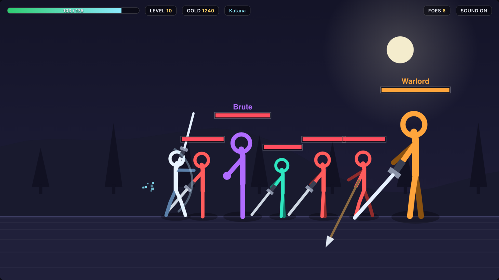
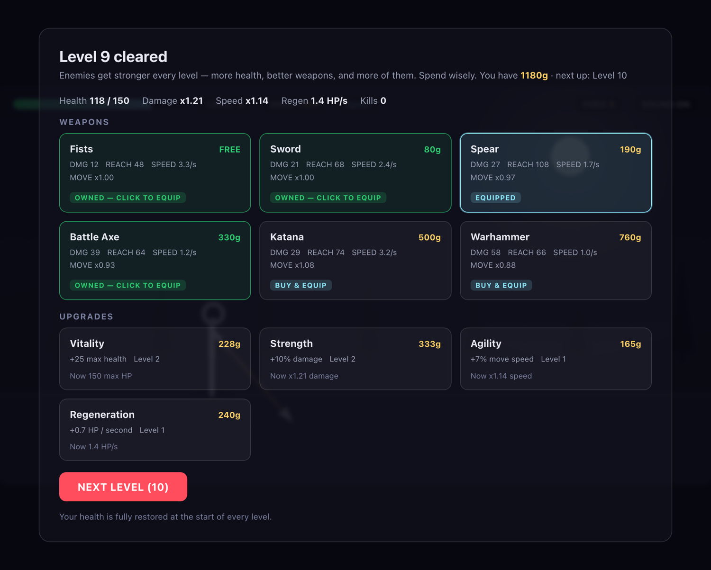

# Stickman Combat



A zero-dependency HTML5 canvas brawler in a **single file**. Open `index.html` in any browser and play — no build step, no `npm install`, no CDN, no internet connection required.

Fight through endless levels. Every level the enemies get tougher: more health, better weapons, and more of them. Earn gold, buy weapons, stack upgrades, and see how deep you can go.

---

## Table of contents

- [Play](#play)
- [Controls](#controls)
- [The loop](#the-loop)
- [Weapons](#weapons)
- [Upgrades](#upgrades)
- [Enemies](#enemies)
- [Difficulty scaling](#difficulty-scaling)
- [How it works](#how-it-works)
  - [Repository layout](#repository-layout)
- [Development notes](#development-notes)
  - [Known limitations](#known-limitations)
- [License](#license)

---

## Play

```
open index.html
```

That is the entire setup. Double-click the file, or drag it into a browser window. Works offline, on any modern browser (Chrome, Safari, Firefox, Edge).

There is no server, no bundler, no package manifest, and no asset files. Everything — sprites, sound effects, UI — is generated in code at runtime.

---

## Controls

| Key | Action |
|---|---|
| `A` / `D` or `←` / `→` | Move left / right |
| `W`, `Space`, or `↑` | Jump |
| `J`, `F`, or **left-click** | Attack |
| `K` or `Shift` | Dash — grants brief invincibility frames |
| `1` – `6` | Switch to an owned weapon by slot |
| `Q` / `E` | Cycle backwards / forwards through owned weapons |
| `P` or `Esc` | Pause |
| `M` or click the HUD chip | Toggle sound |

**The dash is the core skill.** It gives you 0.22s of invincibility on a 0.85s cooldown. Trading hits loses; dashing *through* a heavy swing and punishing the recovery wins. Enemies telegraph their attacks with a visible arc, so a read-and-react player can clear levels a masher cannot.

---

## The loop

1. **Fight.** Clear every enemy in the arena. Your health is fully restored at the start of each level, so the only real reset point is the shop.
2. **Shop.** After each cleared level the shop opens. Spend gold on weapons or repeatable upgrades, then hit **NEXT LEVEL**.
3. **Repeat.** Difficulty rises every level. There is no final level — the run ends when you die, and you get a summary of level reached, kills, gold, and survival time.



You start with **Fists** and **0 gold**, so level 1 must be cleared with your bare hands. That is intentional: your first purchase is a real decision.

---

## Weapons

All six are viable — they trade damage against reach, swing commitment, and movement speed. Buying one *equips* it immediately; owned weapons stay in your inventory and can be swapped mid-fight with `1`–`6` or `Q`/`E`.

| Weapon | Cost | Damage | Reach | Swing | Speed | Move | Notes |
|---|---:|---:|---:|---:|---:|---:|---|
| **Fists** | Free | 12 | 48 | 0.30s | 3.3/s | ×1.00 | Fast, free, and the shortest reach in the game. |
| **Sword** | 80g | 21 | 68 | 0.42s | 2.4/s | ×1.00 | The balanced first buy. Wide arc, no real downside. |
| **Spear** | 190g | 27 | **108** | 0.60s | 1.7/s | ×0.97 | Out-ranges everything. Hit enemies before they can reach you. |
| **Battle Axe** | 330g | 39 | 64 | 0.84s | 1.2/s | ×0.93 | Big damage, wide arc — but you are committed for most of a second. |
| **Katana** | 500g | 29 | 74 | **0.31s** | 3.2/s | **×1.08** | Fast, long, and it makes you *quicker*. The premium pick. |
| **Warhammer** | 760g | **58** | 66 | 1.05s | 1.0/s | ×0.88 | Highest damage in the game. Miss and you eat a free hit. |

Swing speed matters more than the raw damage column suggests. The Katana's 29 damage at 3.2 swings/second is ~93 DPS; the Warhammer's 58 at 1.0/second is ~58 DPS. The Warhammer earns its place through burst and knockback, not sustained output.

Damage is applied as `weapon.damage × your damage multiplier × random(0.90 – 1.12)`.

---

## Upgrades

Four stats, each purchasable repeatedly. The cost grows geometrically, so each one gets meaningfully more expensive — you cannot simply buy your way to invincibility.

| Upgrade | Effect per level | Base cost | Growth |
|---|---|---:|---:|
| **Vitality** | +25 max health | 95g | ×1.55 |
| **Strength** | +10% damage | 130g | ×1.60 |
| **Agility** | +7% move speed | 110g | ×1.50 |
| **Regeneration** | +0.7 HP / second | 150g | ×1.60 |

Cost of each successive purchase, so you can plan:

| Purchase | Vitality | Strength | Agility | Regeneration |
|---|---:|---:|---:|---:|
| 1st | 95 | 130 | 110 | 150 |
| 2nd | 147 | 208 | 165 | 240 |
| 3rd | 228 | 333 | 248 | 384 |
| 4th | 354 | 532 | 371 | 614 |
| 5th | 548 | 852 | 557 | 983 |
| 6th | 850 | 1,363 | 835 | 1,573 |

A key tension: a new weapon costs 80–760g **once**, while upgrades keep climbing. Early on, weapons are the better gold-per-power buy; late on, stacked Strength and Vitality carry you.

---

## Enemies

Enemies spawn from the right edge and hunt you. They approach, occasionally back off to reposition when close, attack when you are in reach, and hop over gaps — Assassins hop deliberately. They also push apart from each other rather than stacking into a single blob.

| Archetype | Appears | Health | Speed | Damage | Size | Gold |
|---|---:|---:|---:|---:|---:|---:|
| **Grunt** | Level 1 | ×1.00 | ×1.00 | ×1.00 | ×1.00 | ×1.00 |
| **Assassin** | Level 4 | ×0.62 | ×1.38 | ×0.88 | ×0.90 | ×1.15 |
| **Brute** | Level 6 | ×2.30 | ×0.76 | ×1.38 | ×1.30 | ×1.85 |
| **Warlord** (boss) | Every 5th level | ×4.40 | ×0.92 | ×1.35 | ×1.62 | ×5.50 |

Assassins are fast and fragile and will close distance aggressively. Brutes are slow damage sponges that hit hard. The Warlord is a genuine wall — expect to spend real time on boss levels.

**Enemy weapons unlock as you progress**, which is the "more weapons for the enemy" ramp:

| Level reached | Weapon added to enemy pool |
|---|---|
| 1 | Fists |
| 3 | Sword |
| 5 | Spear |
| 7 | Battle Axe |
| 9 | Katana |
| 11 | Warhammer |

Enemies also swing faster at higher levels: their attack cooldown shortens until level 10, then holds.

---

## Difficulty scaling

Everything scales with level `n`:

```
enemy health   = 38 + 11n + 1.1 · n^1.70     (before archetype multiplier)
enemy damage   = (5 + weapon.damage × 0.50) × (1 + (n − 1) × 0.07) × archetype multiplier
enemy speed    = (86 + 4.2n) × archetype speed multiplier
enemy count    = min(1 + floor((n − 1) / 2), 8)   — plus a boss on every 5th level
```

The health curve is deliberately super-linear: the linear term keeps early levels readable, while the `n^1.70` term means late levels get genuinely hard rather than just longer.

| Level | Base enemy HP | Damage scale | Enemy speed | Enemies (+boss) |
|---:|---:|---:|---:|---|
| 1 | ~50 | ×1.00 | 90 | 1 |
| 2 | ~64 | ×1.07 | 94 | 1 |
| 3 | ~78 | ×1.14 | 99 | 2 |
| 5 | ~110 | ×1.28 | 107 | 3 **+ boss** |
| 7 | ~145 | ×1.42 | 115 | 4 |
| 10 | ~203 | ×1.63 | 128 | 5 **+ boss** |
| 15 | ~313 | ×1.98 | 149 | 8 |
| 20 | ~437 | ×2.33 | 170 | 8 **+ boss** |

Enemy count caps at 8 from level 15, but health, damage, and speed keep climbing — and every 5th level adds a Warlord on top.

Gold per kill is `(25 + level × 10) × archetype gold multiplier`, so later levels fund the more expensive upgrades, but only if you can survive them.

---

## How it works

Everything lives in `index.html`, in three parts:

- **Inline CSS** — HUD, menu, and shop styling. The canvas is a fixed 960×540 logical resolution scaled to fit the viewport.
- **HTML** — a `<canvas>`, the HUD chips, and an `#overlay` div that is reused for the menu, pause, shop, and game-over screens.
- **One IIFE** — the entire engine, in sections: constants, weapon/upgrade/enemy tables, level config, input, player, enemies, combat resolution, particles, rendering, screens, and boot.

A few implementation notes:

- **Camera.** Renders at a 1.30× zoom and pans horizontally to follow the player, so the fighters fill the frame instead of being specks in a wide arena.
- **Stickman rendering.** Drawn procedurally with line segments, with a walk cycle driven by a phase accumulator. Weapons are drawn as blades of varying length and colour.
- **Audio.** All sound effects are synthesised at runtime with the Web Audio API — short oscillator tones for swings, hits, purchases, and deaths. There are no audio files. Audio initialises on first interaction, as browsers require.
- **Feel.** Hit-stop, knockback, screen shake, hit particles, floating damage numbers, and slash arcs. The dash spawns a particle burst.

### Repository layout

```
.
├── index.html                 the entire game (HTML + CSS + JS, ~1,300 lines)
├── docs/
│   ├── screenshot-combat.png  gameplay screenshot used in this README
│   └── screenshot-shop.png    shop screenshot used in this README
├── .gitignore                 excludes .workbuddy-ai/ and OS/editor noise
└── README.md
```

---

## Development notes

This project was built and verified with headless tooling rather than by eyeballing it:

- **Static syntax check** — the inline script is extracted and run through `node --check`.
- **Headless logic harness** — a Node script stubs the DOM and canvas, then drives the real game loop for tens of thousands of simulated frames with a scripted bot. It asserts that levels advance, the shop opens, purchases apply, and death/restart/pause paths reset state correctly. Run against a fresh checkout this should report zero runtime errors.
- **Rendered screenshots** — headless Chrome captures the real output for visual inspection. The two images in this README were produced that way: the source is patched into a representative mid-run state, input is driven programmatically, and the canvas is captured at 2× device scale.

The harness caught four bugs that would otherwise have shipped broken: a crash on the first frame from reading a non-existent weapon field, a `NaN` damage bug that made the player immortal, enemies walking through the player so hits never landed, and a head drawn detached from the torso.

### Known limitations

- **Difficulty is tuned, not playtested by a skilled human.** The automated bot is deliberately naive — it holds "right" and mashes attack with no dodging, and dies around level 3–5. The late-game curve is derived from the formulas above, not validated by a strong player. If it feels off, the numbers to tune are all in `levelConfig()` and the `WEAPONS` / `UPGRADES` / `TYPES` tables.
- **No persistence.** There are no saves; closing the tab ends the run.
- **Fixed logical resolution.** The canvas scales to fit but does not reflow layout; on very small screens the HUD may feel cramped.
- **Balance is intentionally asymmetric.** The Katana and Warhammer sit at the top of the price curve on purpose; cheaper weapons remain usable rather than becoming strictly obsolete.
- **Screenshots are staged.** The images above come from patched copies of the source that start the player at a mid-run state, so they can show representative content (level 10, a Warlord, several weapon unlocks) without hours of play. The rendering itself is untouched.

---

## License

No license file is included. All rights reserved by the author unless a license is added.
